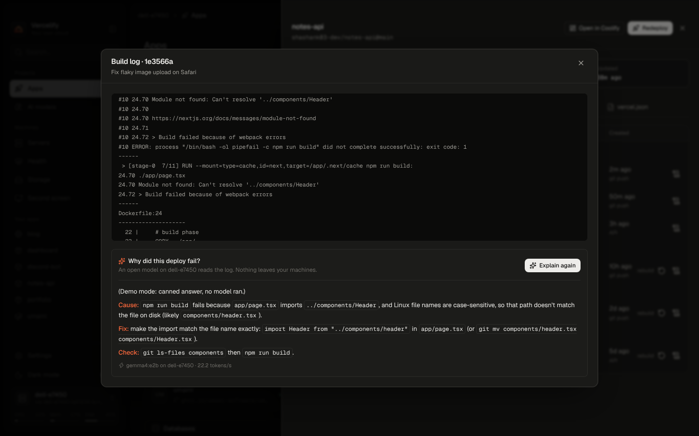
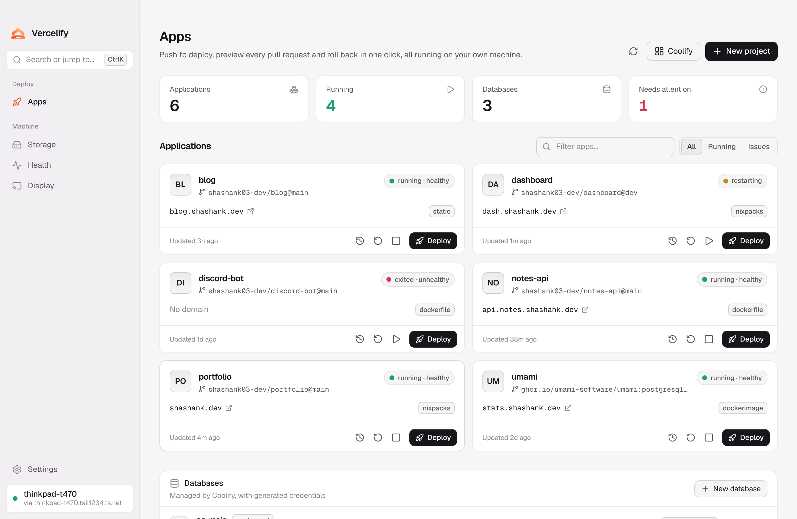
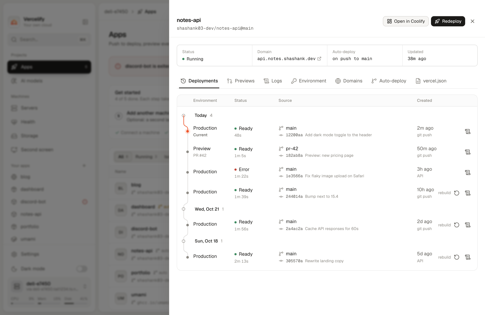
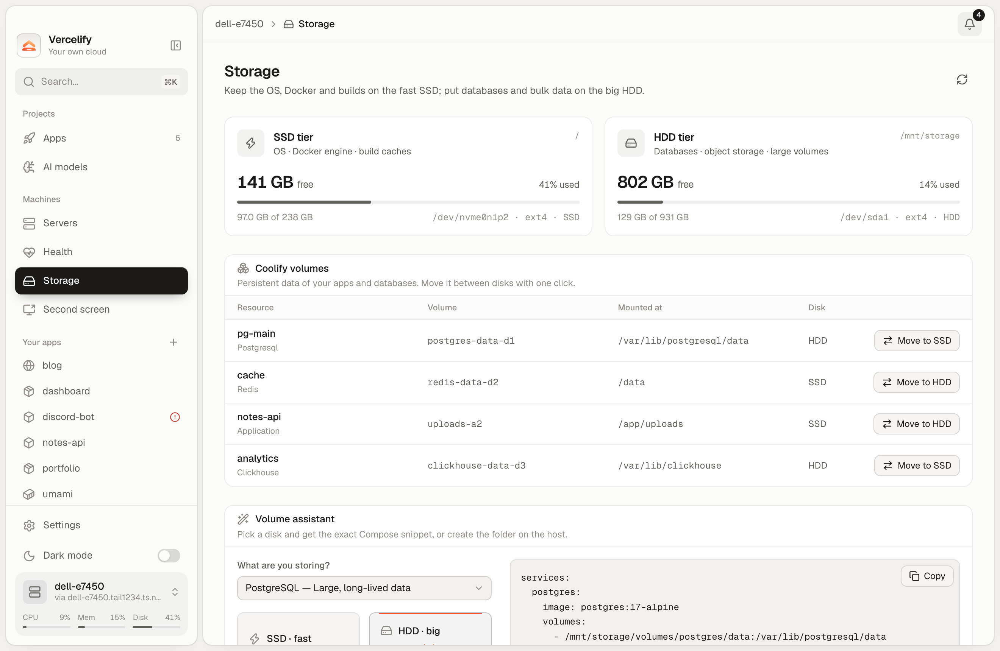
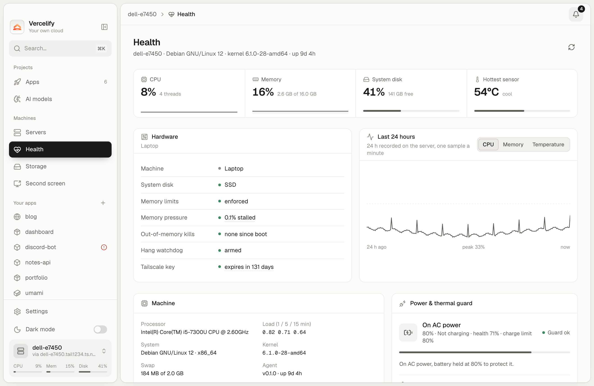

<p align="center">
  
</p>

<h1 align="center">Vercelify</h1>

<p align="center">
  <b>Put your websites online from an old laptop you already own.</b><br/>
  Free. No monthly bill. Controlled from an app on your Mac.
</p>

<p align="center">
  <a href="https://github.com/shashank03-dev/vercelify-oss/releases/latest"></a>
  <a href="https://github.com/shashank03-dev/vercelify-oss/actions/workflows/ci.yml"></a>
  <a href="LICENSE"></a>
</p>

<p align="center">
  <a href="#what-you-can-do">What you can do</a> ·
  <a href="#what-you-need">What you need</a> ·
  <a href="#set-it-up">Set it up</a> ·
  <a href="#try-it-first">Try it first</a> ·
  <a href="#questions">Questions</a>
</p>

---

## What is Vercelify?

Putting a website or app online usually means paying a hosting company every month.
But many people have an old laptop or PC sitting in a drawer that could do the same job.

**Vercelify turns that old computer into your own hosting service.** You connect your
code on GitHub, and your site goes live. Every time you change the code, the site
updates by itself. If a change breaks something, you go back to the last working
version with one click.

You don't need to know how servers work. You install Vercelify once on the old laptop,
install the Vercelify app on your Mac, and do everything else from the app.

It costs nothing to use. The only costs are the ones you already have: electricity for
the laptop and your internet connection (and a domain name, if you want one).

## What you can do

### Put your projects online

- **Publish straight from GitHub.** Pick a repository and click **Deploy**. Websites
  made with Next.js, Vite, React, Express, Python and most other tools work as they
  are.
- **Updates go live by themselves.** Every time you push a change to GitHub, Vercelify
  builds the new version and switches over once it's working. Your site stays up while
  this happens.
- **A preview for every pull request.** Each pull request gets its own temporary link,
  so you can check a change before you merge it.
- **Go back in one click.** Every version is kept. If the new one has a problem, return
  to an earlier one.
- **Private repositories, GitLab and Gitea** work too, after a one-time setup.
- **Run several projects at once.** One old laptop can run many sites, previews and
  databases side by side.

### Understand what went wrong

- **"Why did my deploy fail?"** When a build fails, click **Explain with AI**. A free AI
  model running on your own computer reads the log and tells you, in three short lines,
  what went wrong, how to fix it and how to check the fix. Nothing is sent to an outside
  company.
- **Live logs.** Watch each build as it happens, and read what your app prints while it
  runs.
- **Run AI models for your own apps.** Download free AI models to the laptop from the
  app's **AI models** page and use them in your projects.

### Store your data

- **Databases in one click:** PostgreSQL, MySQL, MongoDB and Redis.
- **Ready-made tools** you can add with one click, such as Umami (visitor statistics)
  and MinIO (file storage).
- **Secret settings** like passwords and API keys are stored encrypted, and you can copy
  them to your Mac with one command when you work on your code.
- **Nightly backups.** Your apps' data is backed up every night, encrypted, to a second
  disk, another computer or online storage, and you can restore it when you need to.

### Share your sites safely

- **Private by default.** Your apps can only be reached from your own devices until you
  decide to make one public.
- **Your own web address with the padlock (HTTPS).** Use a domain like
  `blog.yourname.com`. This works even when your internet provider doesn't let other
  people connect to your home (common on mobile and some home connections). You don't
  have to change any router settings.
- **Reach your server from anywhere.** Take your Mac to a café or school and it still
  connects to the laptop at home, over an encrypted connection. Turn it on with one
  command; there's no account to create.
- **Your private apps open in your normal browser** on the Mac, without making them
  public.
- **Lose a device?** Remove its access from the server in one step.

### Look after the old laptop

- **Works with the lid closed** and keeps running when you're not around.
- **Watches the hardware:** temperature, battery, memory and disk space, with a warning
  before something runs out.
- **Protects the battery** and slows things down if the laptop gets too hot.
- **Puts quiet apps to sleep** to free memory on small machines. The next visitor wakes
  the app up in a second or two.
- **Installs security updates by itself** at night (on from the start), and restarts
  only when an update needs it and nothing important is running.
- **Safe updates.** Updating Vercelify keeps all your apps and data. If an update goes
  wrong, it goes back to the previous version by itself.
- **A health check** (`sudo vercelify doctor`) looks at everything and tells you, in
  plain words, what to fix.

### Use the laptop's screen too

- **A second screen for your Mac.** Use the laptop's screen as an extra monitor: drag
  windows onto it, or show a copy of your Mac's screen.
- **Control the laptop's desktop from your Mac**, with the free Moonlight app. The app
  sets up the connection for you.

### Grow when you need to

- **Add more computers.** Another old laptop or a Raspberry Pi can join and share the
  work.
- **A backup server.** A second machine can keep a copy of everything and take over if
  the main one dies.

### For people coming from Vercel

- Vercelify understands the usual parts of a `vercel.json` file: redirects, rewrites,
  headers and scheduled jobs. See [what's supported](docs/VERCEL-PARITY.md).
- **`vfy`**, a command-line tool for the Mac, lets you deploy, read logs, roll back and
  copy settings from the terminal.

## See it

<p align="center">
  
  <br/><sub>A failed build, explained: what went wrong, how to fix it, and how to check.</sub>
</p>

<table>
  <tr>
    <th width="50%">Your apps</th>
    <th width="50%">Every version, with its log</th>
  </tr>
  <tr>
    <td>
      <picture>
        <source media="(prefers-color-scheme: dark)" srcset="docs/screenshots/apps.png" />
        
      </picture>
    </td>
    <td>
      <picture>
        <source media="(prefers-color-scheme: dark)" srcset="docs/screenshots/deployments.png" />
        
      </picture>
    </td>
  </tr>
  <tr>
    <th>Disks and storage</th>
    <th>Laptop health</th>
  </tr>
  <tr>
    <td>
      <picture>
        <source media="(prefers-color-scheme: dark)" srcset="docs/screenshots/storage.png" />
        
      </picture>
    </td>
    <td>
      <picture>
        <source media="(prefers-color-scheme: dark)" srcset="docs/screenshots/health.png" />
        
      </picture>
    </td>
  </tr>
</table>

## What you need

| | What | Details |
| --- | --- | --- |
| 🖥️ | **An old laptop or PC** | 64-bit, Intel or AMD. 4 GB of memory works, 8 GB is better. At least 20 GB of free disk space. |
| 🐧 | **Ubuntu on that computer** | Ubuntu 24.04 or 22.04 (Debian 12 and 13 work too). Still on Windows? Ubuntu's [install guide](https://ubuntu.com/tutorials/install-ubuntu-desktop) shows how to replace it. **Copy anything you want to keep off the computer first.** |
| 💻 | **A Mac** | The Vercelify app runs here. (There's also a Linux version.) |
| 🌐 | **Internet** on both | A cable on the old laptop is the most reliable, but Wi-Fi works. |

You don't need a domain name, a Cloudflare account, an AI subscription or a credit
card to start.

## Set it up

Plan for about 30 minutes, most of it waiting for downloads.

### 1. Install Vercelify on the old laptop

On the old laptop, open **Terminal** (press <kbd>Ctrl</kbd>+<kbd>Alt</kbd>+<kbd>T</kbd>) and
paste these two lines, one after the other:

```bash
sudo apt update && sudo apt install -y curl
```

```bash
curl -fsSL https://raw.githubusercontent.com/shashank03-dev/vercelify-oss/main/install.sh | sudo bash -s -- --storage-device none
```

Type your password when it asks (nothing shows while you type; that's normal).

<p align="center">
  
  <br/><sub>The installer, shortened. The real run takes 10 to 20 minutes.</sub>
</p>

The installer checks the computer, installs everything, and tells you if something is
missing. At the end it shows **a line to paste on your Mac** and **an 8-letter pairing
code** (like `K7QF-M2XD`). Keep that window open.

From now on, leave the laptop plugged in and online. You can close the lid.

> **Have a second disk in the laptop?** Use `--storage-device /dev/sdb` (your disk's
> name) instead of `--storage-device none` to keep databases and backups on it.
> Vercelify never erases a disk unless you also add `--format-storage`.

### 2. Install the app on your Mac

On your Mac, open **Terminal** (press <kbd>⌘</kbd>+<kbd>Space</kbd> and type *Terminal*) and
paste the line the laptop showed you. It looks like this:

```bash
curl -fsSL https://raw.githubusercontent.com/shashank03-dev/vercelify-oss/main/install-mac.sh | bash -s -- --pair vfy2.…
```

This installs the Vercelify app in your Applications folder and connects it to your
laptop. When the app opens, you're ready.

> Prefer to download the app yourself? Get the `.dmg` from the
> [latest release](https://github.com/shashank03-dev/vercelify-oss/releases/latest) and
> drag Vercelify to Applications. The first time, **right-click the app and choose
> Open**, because it isn't notarized by Apple. Then pick your laptop in the app and type
> the 8-letter code.

### 3. Put your first project online

1. In the app, click **New app**.
2. Paste the address of a GitHub repository.
3. Pick the branch (usually `main`) and add any settings your app needs.
4. Click **Deploy** and watch it build.

When it's done, you get a link to your running app. If the build fails, open it and
click **Explain with AI**.

## Extra features

Each of these is one command on the laptop, whenever you want it.

| To do this | Run this on the laptop |
| --- | --- |
| Reach the laptop from anywhere | `sudo vercelify remote on` |
| Use your own web address | `sudo vercelify domain yourname.com` ([how](docs/PLATFORM.md#1-domains-and-https)) |
| Turn on **Explain with AI** | `sudo vercelify ai install` then `sudo vercelify ai pull gemma4:e2b` ([which model?](docs/AI.md)) |
| Back up every night | `sudo vercelify backup setup` ([how](docs/BACKUPS.md)) |
| Control the laptop's desktop from the Mac | `sudo vercelify desktop on`, then **Launch Moonlight** in the app |
| Put quiet apps to sleep | `sudo vercelify sleep on APP` |
| Pair another Mac | `sudo vercelify pair` |
| See every device that has access, and remove one | `sudo vercelify tokens` |
| Update Vercelify | `sudo vercelify update` |
| Check that everything is fine | `sudo vercelify doctor` |

The second screen needs nothing extra: open **Second screen** in the app and press
**Start**.

## Try it first

You can look around before you set up a laptop.

**See the app with sample data.** You need [Node.js](https://nodejs.org/) and
[Git](https://git-scm.com/downloads):

```bash
git clone https://github.com/shashank03-dev/vercelify-oss.git
cd vercelify-oss/cockpit && npm ci && VITE_DEMO=1 npm run dev
```

Open [localhost:1420](http://localhost:1420), pick the server **dell-e7450** and type the
code `K7QF-M2XD`. Everything you see is made up, so feel free to click anything.

**Ask the AI about a failed build.** Install [Ollama](https://ollama.com/download) (a free
app that runs AI models on your computer) and open it once. Then, in the
`vercelify-oss` folder:

```bash
ollama pull gemma4:e2b
./cli/vfy why --log cli/examples/failed-build.log
```

It reads a real failed build log and answers with what went wrong, the fix and a way to
check it. The model is a few gigabytes to download; after that it works offline.

## Questions

**Is it really free?**
Yes. Vercelify is open source and has no paid plan. You pay only for electricity, your
internet, and a domain name if you want one. The optional connection for public sites
uses Cloudflare's free plan.

**Is my data safe?**
Your apps and data stay on your own laptop. Your devices talk to it over an encrypted
connection, apps stay private until you publish them, and you can remove any device's
access at any time. Backups are encrypted. More in [security](SECURITY.md).

**Will an old laptop be fast enough?**
For personal sites, side projects, school work and small apps, yes. A 2017 laptop with 8 GB
of memory runs several apps and databases at once. Vercelify is built to use little
memory and keeps an eye on the hardware for you.

**What happens when the laptop is off?**
Your sites are offline until it's back. Vercelify starts everything again by itself when
the laptop turns on. A second machine can be set up as a backup server that takes over.

**Something isn't working.**
Run `sudo vercelify doctor` on the laptop. It checks everything and says what to do. If
the installer stopped, fix what it mentions and run the same line again; finished steps
are skipped. More answers in [troubleshooting](docs/TROUBLESHOOTING.md).

**Is this made by Vercel?**
No. Vercelify is an independent project, inspired by how simple Vercel makes publishing.

## Guides

| Guide | What it covers |
| --- | --- |
| [Platform](docs/PLATFORM.md) | Domains, private repositories, databases, more computers |
| [Automatic deploys](docs/AUTODEPLOY.md) | Updating on every push, previews for pull requests |
| [Network](docs/MESH.md) | Reaching the laptop from anywhere, adding devices |
| [AI](docs/AI.md) | Choosing and running AI models |
| [Backups](docs/BACKUPS.md) | Nightly backups and getting your data back |
| [Second screen](docs/DISPLAY.md) | Using the laptop as an extra monitor |
| [More servers](docs/SERVERS.md) · [Raspberry Pi](docs/RASPBERRY-PI.md) | Adding computers |
| [Project settings](docs/PROJECT-CONFIG.md) | `vercel.json`, scheduled jobs, access rules |
| [Troubleshooting](docs/TROUBLESHOOTING.md) | Fixing common problems |

## For developers

<details>
<summary><b>How it's built</b></summary>

<p align="center">
  <picture>
    <source media="(prefers-color-scheme: dark)" srcset="docs/diagrams/architecture-dark.svg" />
    
  </picture>
</p>

- **Mac app:** Tauri v2, React 19, TypeScript, Tailwind ([`cockpit/`](cockpit))
- **On the server:** one small Rust program, the agent, with its own build and deploy
  engine ([`agent/`](agent), [`crates/vercelify-platform`](crates/vercelify-platform))
- **Private network:** `vercelify-mesh`, Vercelify's own WireGuard network with direct
  connections and a relay ([`crates/vercelify-mesh`](crates/vercelify-mesh))
- **Installer and admin tool:** Bash, tested with bats and ShellCheck ([`host/`](host))
- **Command line:** [`cli/vfy`](cli/vfy)
- **Built on:** Docker and BuildKit (builds and apps), Traefik (web traffic and HTTPS),
  WireGuard via boringtun (the network), Ollama (AI)

Read more in [architecture](docs/ARCHITECTURE.md), the
[design](docs/design/SYSTEM-DESIGN.md) and [development](docs/DEVELOPMENT.md).
[`skills/vercelify`](skills/vercelify/SKILL.md) teaches AI coding assistants to deploy
and fix apps with `vfy`.

</details>

<details>
<summary><b>Build it and run the tests</b></summary>

```bash
./dev setup        # install the tools
./dev check all    # every test the CI runs
./dev app          # the Mac app, from this checkout
./dev host user@laptop   # install this checkout on a laptop
```

[DEVELOPMENT.md](docs/DEVELOPMENT.md) covers the network, installer and end-to-end tests.

</details>

## Contributing

Bug reports, fixes and ideas are welcome. Start with [CONTRIBUTING.md](CONTRIBUTING.md),
and open an issue first for bigger changes. Please follow the
[Code of Conduct](CODE_OF_CONDUCT.md) and report security problems privately as
described in [SECURITY.md](SECURITY.md).

## License and thanks

Vercelify is released under the [MIT License](LICENSE). AI models such as Gemma keep
their own licenses.

Vercelify is built on [Docker](https://github.com/moby/moby),
[BuildKit](https://github.com/moby/buildkit), [Traefik](https://github.com/traefik/traefik),
[WireGuard](https://www.wireguard.com) and [boringtun](https://github.com/cloudflare/boringtun),
[Ollama](https://github.com/ollama/ollama), [Gemma](https://ai.google.dev/gemma),
[Sunshine](https://github.com/LizardByte/Sunshine), [Moonlight](https://moonlight-stream.org)
and [Tauri](https://github.com/tauri-apps/tauri). It is not affiliated with Vercel.
